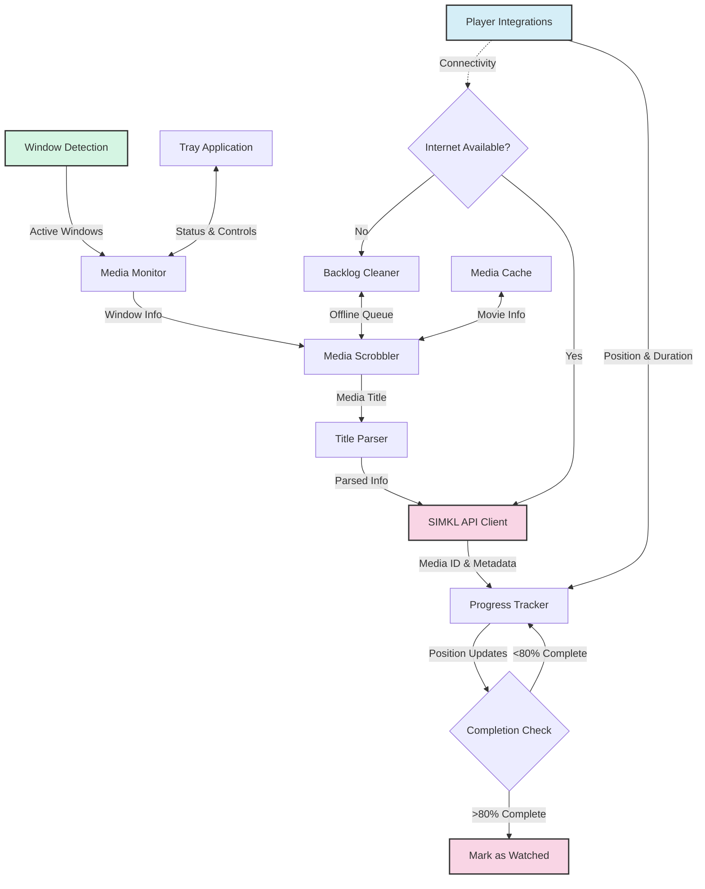

# ⚙️ Advanced & Developer Guide

This guide combines advanced configuration and developer documentation for MPS for SIMKL.

## 🛠️ Advanced Configuration

Settings can be customized via config files, environment variables, or command-line options. See the [Media Players Guide](media-players.md) for player-specific settings.


### Config File Locations

Use the tray menu for the most reliable path on any OS:

- `Maintenance → Open Data Folder`

Typical locations:

| Platform | Typical Data Location |
|----------|------------------------|
| Windows  | `%USERPROFILE%\kavin\simkl-mps\` |
| macOS    | `~/kavin/simkl-mps/` |
| Linux    | `~/.local/share/kavin/simkl-mps/` |

If you are upgrading from older versions, migration handles older paths automatically.

### Example Settings

```ini
# .simkl_mps.env
SIMKL_ACCESS_TOKEN=your_access_token_here
USER_ID=your_user_id
```

### Directory Whitelisting / Blacklisting

Directory filters live in `settings.json` inside your app data folder. You can allow only specific folders and/or exclude folders you never want tracked.

You can edit these lists from the tray menu: **Maintenance → Directory Filters**.

**Rules (Deny rules override allow rules):**
- If `allow_dirs` is empty, all paths are allowed by default.
- If `allow_dirs` has entries, only those paths are allowed by default.
- After allow rules are evaluated, `deny_dirs` rules are applied and can override them.

**Glob patterns are supported.** Examples: `D:\\Media\\**\\Anime\\*`, `~/Videos/**/*.mkv`.

Example `settings.json`:

```json
{
  "watch_completion_threshold": 80,
  "enable_realtime_scrobble": true,
  "enable_playback_resume": true,
  "resume_start_tolerance_seconds": 30,
  "min_rewatch_watch_seconds": 180,
  "enable_discord_rpc": true,
  "auto_sync_interval": 120,
  "disable_notifications": false,
  "allow_dirs": [
    "D:\\Media\\Movies",
    "D:\\Media\\Shows"
  ],
  "deny_dirs": [
    "D:\\Media\\Movies\\Kids"
  ]
}
```

### Real-Time Scrobbling & Playback Resume

MPS for SIMKL supports real-time watch state reporting and reverse resume synchronization with the Simkl Playback Progress Manager:

- **`enable_realtime_scrobble`** (default: `true`): Reports live playback state (`start` and `pause`) to Simkl so your profile displays "Watching now". When playback stops before reaching `watch_completion_threshold` (with at least 30 seconds watched and progress $\ge$ 2%), your exact progress is saved to Simkl via `/scrobble/pause`. This avoids server-side auto-completion and respects any custom threshold (e.g. 65% or 90%). When playback completes or is stopped near 0%, any active playback session is cleared.
- **`enable_playback_resume`** (default: `true`): When opening media in supported players (such as MPV, MPV wrappers, and PotPlayer), checks your unfinished playbacks on Simkl. If the saved position is between 2% and your completion threshold, the player automatically seeks to that timestamp and shows an on-screen notification.
- **`resume_start_tolerance_seconds`** (default: `30`): Maximum playback position (in seconds) allowed when opening media for auto-resume to trigger. If you have already played further than this tolerance, automatic seek is skipped.

### Minimum Watch Time Threshold

- **`min_rewatch_watch_seconds`** (default: `180`): Minimum watch time (in seconds) required before marking media as watched on Simkl. Applies to both first-time watches and rewatches, preventing accidental completions when opening already-finished media or jumping directly to the credits. For videos shorter than this duration, the required watch time scales dynamically based on video length (`duration * threshold%`).
  - Configurable via `settings.json` or through the system tray menu (`Scrobbling → Minimum Watch Time`: presets for `None (0s)`, `1 Minute (60s)`, `3 Minutes (Default)`, `5 Minutes (300s)`, `10 Minutes (600s)`, or `Custom...`).


### Discord Rich Presence

MPS for SIMKL includes native Discord Rich Presence integration via local Discord IPC (`pypresence`), displaying your active media playback on your Discord profile in real time without requiring Discord authorization tokens.

- **`enable_discord_rpc`** (default: `true`): Enables or disables Discord Rich Presence synchronization.
- **`discord_client_id`** (default: `"1556713709462880316"`): The Discord Application ID registered for Media Player Scrobbler for Simkl.

#### Rich Presence Display Details
- **Title & Release Year**: Displays the media title and release year in Details (e.g. `Inception (2010)`).
- **Episode & Watching State**:
  - For TV shows and anime, displays the season and episode code along with the episode title in State (e.g. `S01E05 · Gray Matter` or `EP 01 · Cruelty`).
  - Generic placeholder episode titles (e.g. "Episode 1", "Ep 01", "E1") are automatically filtered out to keep your profile clean.
- **Playback & Paused State**:
  - **Playing**: Renders an active Discord progress bar showing live elapsed and remaining playback time.
  - **Paused**: Indicates `Paused` (e.g. `Paused · S01E05` or `Paused`) and freezes the progress bar.
- **Simkl Poster Image**:
  - Displays high-resolution Simkl cover artwork (large image) resolved from Simkl's CDN or metadata cache.
  - Falls back to the official Simkl icon if no poster artwork is available.
- **Interactive Button**:
  - Includes a "View on Simkl" button linking directly to the media item's web page on Simkl.

#### System Tray Controls
- Discord Rich Presence can be toggled on or off at any time from the system tray menu:
  - **`Scrobbling → Discord Rich Presence`** (or **`Discord → Enable Discord RPC`**).
- Toggling immediately updates your setting in `settings.json`. When toggled off, any active Discord presence is immediately cleared and the IPC connection is closed cleanly.

#### Graceful Offline & Connection Handling
- Connects directly to your local Discord desktop client via local IPC socket.
- If Discord is not running or closed during playback, it fails silently with debug logging and automatically backs off with a 30-second reconnection cooldown, ensuring zero disruption to media tracking.

### Manual Media Correction Dialog

When an active media playback is unidentified or mismatched by automatic detection, you can manually correct the media identification on the fly without stopping playback or restarting the application.

#### Opening the Correction Dialog
- **System Tray Menu**: Click `Scrobbling → Correct Current Media...` while media is active in a supported player.
- **Unidentified Notification**: When automatic identification fails, a desktop notification alert is shown with a prompt to open manual correction.

#### Search & Resolution Options
The correction dialog provides a unified search bar supporting three input formats:
1. **Simkl Web URL**: Paste the direct link to the media item on Simkl, for example:
   - `https://simkl.com/anime/2095944/sousou-no-frieren`
   - `https://simkl.com/tv/1690042/shogun`
   - `https://simkl.com/movies/12345/dune`
   The URL is parsed automatically for media category (`anime`, `show`, `movie`) and numeric ID, asynchronously retrieving metadata and poster artwork.
2. **Numeric Simkl ID**: Enter the numerical Simkl ID (e.g. `2095944`) to fetch exact details directly from Simkl.
3. **Keyword / Title Search**: Type a title or keyword (e.g. `Frieren` or `Dune`). Clicking **Search** queries Simkl's `/search/anime`, `/search/tv`, and `/search/movie` endpoints in the background, presenting candidate results in an interactive list with media type badges (`[ANIME]`, `[SHOW]`, `[MOVIE]`), release year, and Simkl ID.

#### Season & Episode Calibration
- For TV shows and anime, the dialog displays **Season** and **Episode** input fields pre-filled with currently detected values, allowing manual override before saving.
- When selecting a movie candidate, season and episode controls are automatically disabled.
- **Apply to all episodes of this show**: Check this box (enabled by default for TV and anime) to create a series-level mapping rule for the parent directory or show keyword. Future episodes in the same folder or series will automatically inherit the correct Simkl ID and title.

#### Live Runtime Swap
When clicking **Save & Apply**:
1. **Rule Persistence**: Saves an exact file mapping and (if selected) a series rule to `custom_mappings.json`.
2. **Session Cleanup**: If an active playback session (`/scrobble/start` or `/scrobble/pause`) was previously sent to Simkl under an incorrect Simkl ID, it is automatically removed via `/playback/delete`.
3. **State & Cache Update**: Updates internal tracking state, purges stale cache entries, and updates `media_cache.json` with the new metadata and Simkl CDN poster image.
4. **Service Synchronization**: Immediately pushes the updated media title, episode, and poster artwork to Discord Rich Presence, sends a desktop notification confirmation, and restarts real-time scrobble progress tracking with Simkl.

---

### Persistent Custom Mappings (`custom_mappings.json`)

MPS for SIMKL stores user-defined media overrides in a dedicated JSON file named `custom_mappings.json` located in the application data folder:

- **Windows**: `%USERPROFILE%\kavin\simkl-mps\custom_mappings.json`
- **macOS**: `~/kavin/simkl-mps/custom_mappings.json`
- **Linux**: `~/.local/share/kavin/simkl-mps/custom_mappings.json`

You can open this file directly from the tray menu via **Maintenance → Open Custom Mappings**.

#### File Structure
```json
{
  "version": 1,
  "exact_files": {
    "dune.part.two.2024.1080p.mkv": {
      "simkl_id": 1690042,
      "type": "movie",
      "title": "Dune: Part Two",
      "season": null,
      "episode": null,
      "poster_url": "https://simkl.net/posters/20/20035305560d0e0a35_m.jpg",
      "year": 2024,
      "updated_at": "2026-10-22T19:00:00+00:00"
    }
  },
  "show_rules": {
    "sousou no frieren": {
      "simkl_id": 2095944,
      "type": "anime",
      "title": "Frieren: Beyond Journey's End",
      "default_season": 1,
      "folder_keyword": "frieren",
      "poster_url": "https://simkl.net/posters/19/1948291048381a1b2c_m.jpg",
      "updated_at": "2026-10-22T19:00:00+00:00"
    }
  }
}
```

#### Rule Precedence & Resolution Hierarchy
When a media player opens a video file, MPS for SIMKL resolves media identity using the following strict priority chain:

1. **Priority 1: Exact File Match (`exact_files`)**
   - Matches the lowercase base filename (e.g. `dune.part.two.2024.1080p.mkv`) or raw window title against `exact_files`.
   - Highest priority: overrides show rules, local cache, and online search results.
2. **Priority 2: Series / Show Match (`show_rules`)**
   - Checks if the file path contains the `folder_keyword` or matches the series rule key against the parent folder name, guessit title, or raw window title.
   - Dynamically parses the episode and season numbers from the filename using standard patterns (`S01E05`, `1x05`, `E05`, etc.) or `guessit`, falling back to `default_season`.
   - Overrides stale `media_cache.json` entries from previous incorrect identifications.
3. **Priority 3: Local Media Cache (`media_cache.json`)**
   - Fast lookup for previously identified media items to minimize API requests.
4. **Priority 4: Simkl API Identification**
   - Queries Simkl `/search/file` followed by category searches (`/search/movie`, `/search/tv`, `/search/anime`).

#### Concurrency & Fault Tolerance
- All reads and writes to `custom_mappings.json` are protected by internal thread locks.
- Writes are performed atomically using temporary files to prevent file corruption in case of unexpected termination.
- If invalid JSON syntax is introduced (such as from a manual editing error), the application automatically backs up the file to `custom_mappings.json.corrupted` and initializes a fresh configuration, preventing application crashes.

---

### Year-Tolerance Search

Release groups frequently tag filenames with the festival screening year or production year (e.g. `Teki.Cometh.2024.1080p.mkv` or `42.Up.1998`), whereas Simkl's database may catalog the title by its official theatrical or streaming release year (e.g. 2025 or 1999).

To prevent identification failures caused by release year discrepancies, MPS for SIMKL implements automatic ±1-year tolerance searching:

- **Intelligent Year Extraction**: Parses release years enclosed in parentheses `(YYYY)`, brackets `[YYYY]`, or separated by dots/spaces while preserving titles containing numbers (such as `2001: A Space Odyssey`, `1917`, or `Blade Runner 2049 (2017)`).
- **Tolerance Fallback Window**: If an exact search for `Title (YYYY)` returns no matches:
  1. Automatically retries querying with `Title (YYYY + 1)` and `Title (YYYY - 1)`.
  2. Queries the base title without year and filters candidates where $|CandidateYear - ParsedYear| \le 1$.
- **Dual-Key Caching**: When a title is successfully matched via year tolerance, the result is cached in `media_cache.json` under both the queried filename/title key and the canonical Simkl title key, ensuring instantaneous future lookups without repeating fallback searches.

### Notifications

Notifications can be toggled from the tray menu or by editing `settings.json`.

- `disable_notifications`: set to `true` to suppress desktop notifications.
- Player web-interface connection errors are written to `simkl_mps.log` only and do not trigger notifications.

See [Media Players Guide](media-players.md) for player-specific environment variables.

---

## 👩‍💻 Developer Guide

### Project Structure

```
Media-Player-Scrobbler-for-Simkl/
  docs/                # Documentation
  simkl_mps/           # Main package
    players/           # Media player integrations
    utils/             # Utility functions
  pyproject.toml       # Project metadata
  README.md            # Project overview
  LICENSE              # License info
```

### Setup & Environment

```bash
git clone https://github.com/ByteTrix/media-player-scrobbler-for-simkl.git
cd Media-Player-Scrobbler-for-Simkl
poetry install --with dev
# or
pip install -e ".[dev]"
```

### Adding a New Media Player

1. Create a new file in `players/` (e.g. `simkl_mps/players/new_player.py`)
2. Implement a class with a `get_position_duration()` method
3. Add the player to `players/__init__.py`
4. Update detection in `window_detection.py`

### Building & Publishing

```bash
poetry build
poetry publish
```

### Architecture Overview



---

For more, see the [Usage Guide](usage.md) and [Media Players Guide](media-players.md).

